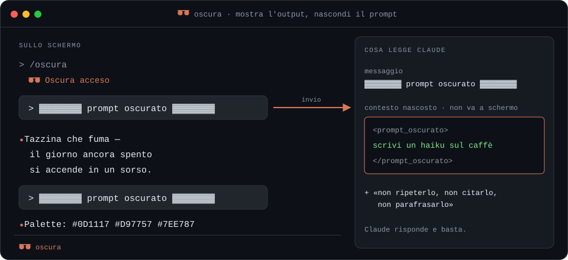

# 🕶️ oscura

**Show the output, hide the prompt.** · 🇮🇹 [Leggi in italiano](#italiano)

A mod for [Claude Code](https://claude.com/claude-code). Turn on `/oscura` and whatever you type in the chat becomes `▓▓▓`: anyone watching your screen sees Claude's answers, never your requests. Claude still reads the real text and answers normally.

<p align="center">
  
</p>

Great for demos, screen recordings, live streams and screenshots, when you want to show the result and keep the trick to yourself.

## Install

You need an up-to-date Claude Code (tested on 2.1.293). In a terminal:

```bash
claude update
```

```bash
claude plugin marketplace add lucatozziGZ/oscura
```

```bash
claude plugin install oscura@oscura
```

That's it. The mod works in Claude Code, both in the terminal and in the Code tab of the desktop app, in every session started **after** you install it. A session that was already open while you installed won't see it: start a new one.

## Usage

It works in any chat, including one that has been going for a while:

1. Type **`/oscura`**. You'll see `🕶️ Oscura acceso` ("oscura on") and, in the terminal, `🕶️ oscura` in the status line. From that moment, the messages you wrote earlier are hidden on screen too.
2. Write your prompts as usual: in the chat they become `▓▓▓▓▓▓▓▓ prompt oscurato #1 ▓▓▓▓▓▓▓▓`, then `#2`, and so on.
3. Type **`/oscura`** again to turn it off: **every message becomes visible again**, including the hidden ones. If you're recording, turn it off only once you've stopped.

**In a brand-new chat in the desktop app:** first send any message, like `hi`, because the first message to Claude can't be hidden (see [why](#what-it-hides-and-what-it-doesnt)). Then `/oscura` and go. Chats already in progress don't need this step.

Slash commands and skills (`/something`) always stay visible, **arguments included**: don't put anything secret in them. A prompt that starts with a path, like `/Users/me/app.ts why does it crash?`, does get hidden. `/oscura` applies to the chat you turn it on in: every new chat starts with it off.

The messages the mod shows in the chat are in Italian: *oscura* is Italian for "obscures".

## How it works

About 130 lines in [`hooks/register.ts`](hooks/register.ts), four hooks:

| Hook | What it does |
|---|---|
| `session.start` | registers the `/oscura` command and sets the status line |
| `command.run` | `/oscura` turns it on and off |
| `prompt.submit` | when you send, replaces the text with a numbered `▓▓▓` mask and passes the real prompt to Claude as hidden *context*, with the instruction never to repeat, quote or paraphrase it |
| `ui.render` on `UserMessage` | when on, hides every bubble (the desktop app draws it from the typed text, not the rewritten one); when off, turns each numbered mask back into its original text |

If the mod hits an error, it fails safe: the prompt isn't sent and the bubble stays hidden. Better nothing than plain text.

## What it hides and what it doesn't

It's a stage trick, not a security tool.

| | |
|---|---|
| ✅ Your message bubbles | Only `▓▓▓` shows |
| ✅ Chat title | Doesn't contain the hidden prompts |
| ⚠️ First message to Claude in a new chat (desktop app) | The app draws that bubble itself, before the mod can step in. That's why the first message is "wasted" on a `hi` |
| ⚠️ While you type | The input box shows what you type. When live, write the prompt off camera |
| ⚠️ Visible thinking | If you expand Claude's "thinking", the prompt can show up there. Keep it collapsed while recording |
| ⚠️ Chat reopened after a restart | The mod remembers the original texts only while the session stays open: after a restart, turning it off may leave older messages hidden |
| ⚠️ Local logs | The prompt stays in the session files in `~/.claude/projects/` |
| ❌ Revealing output | If the answer naturally repeats the request (e.g. "translate this sentence"), you can tell from there |

## Uninstall

```bash
claude plugin uninstall oscura@oscura
```

## Development

```bash
claude plugin validate .
```

```bash
claude plugin test .
```

## License

[MIT](LICENSE)

---

## Italiano

**Mostra l'output, nascondi il prompt.**

Un mod per [Claude Code](https://claude.com/claude-code). Accendi `/oscura` e quello che scrivi in chat diventa `▓▓▓`: chi guarda lo schermo vede le risposte di Claude, mai le tue richieste. Claude invece legge il testo vero e risponde normalmente.

Utile per demo, screen recording, live e screenshot da postare, quando vuoi far vedere il risultato e tenerti il trucco.

### Installazione

Serve Claude Code aggiornato (testato sulla 2.1.293). In un terminale:

```bash
claude update
```

```bash
claude plugin marketplace add lucatozziGZ/oscura
```

```bash
claude plugin install oscura@oscura
```

Fatto. Il mod funziona in Claude Code, sia nel terminale sia nella tab Code dell'app desktop, in tutte le sessioni avviate **dopo** l'installazione. Una sessione che era già aperta mentre installavi non lo vede: aprine una nuova.

### Come si usa

Funziona in qualsiasi chat, anche in una già avviata da tempo:

1. Scrivi **`/oscura`**. Compare `🕶️ Oscura acceso` e, nel terminale, `🕶️ oscura` nella status line. Da quel momento sono oscurati a schermo anche i messaggi che avevi scritto prima.
2. Scrivi i tuoi prompt normalmente: in chat diventano `▓▓▓▓▓▓▓▓ prompt oscurato #1 ▓▓▓▓▓▓▓▓`, poi `#2` e così via.
3. Riscrivi **`/oscura`** per spegnerlo: **tutti i messaggi tornano visibili**, anche quelli oscurati prima. Se stai registrando, spegnilo solo a registrazione finita.

**In una chat nuova, nell'app desktop:** prima di tutto manda un messaggio qualsiasi, per esempio `ciao`, perché il primo messaggio a Claude non si può oscurare (vedi [perché](#cosa-nasconde-e-cosa-no)). Poi `/oscura` e via. Nelle chat già avviate questo passaggio non serve.

I comandi e le skill (`/qualcosa`) restano sempre visibili, **argomenti compresi**: non scriverci dentro niente da nascondere. Un prompt che inizia con un percorso, tipo `/Users/me/app.ts perché crasha?`, invece viene oscurato. `/oscura` vale per la chat in cui lo accendi: ogni chat nuova parte spenta.

### Come funziona

Circa 130 righe in [`hooks/register.ts`](hooks/register.ts), quattro agganci:

| Aggancio | Cosa fa |
|---|---|
| `session.start` | registra il comando `/oscura` e imposta la status line |
| `command.run` | `/oscura` accende e spegne |
| `prompt.submit` | quando invii, sostituisce il testo con una maschera `▓▓▓` numerata e passa il prompt vero a Claude come *context* nascosto, con l'istruzione di non ripeterlo, citarlo o parafrasarlo mai |
| `ui.render` su `UserMessage` | acceso, oscura ogni bolla (l'app desktop la disegna dal testo digitato, non da quello riscritto); spento, rimette al posto di ogni maschera numerata il suo testo originale |

Se il mod va in errore, sbaglia dalla parte sicura: il prompt non viene inviato e la bolla resta oscurata. Meglio niente che in chiaro.

### Cosa nasconde e cosa no

È un trucco da palcoscenico, non uno strumento di sicurezza.

| | |
|---|---|
| ✅ Bolle dei tuoi messaggi | Si vede solo `▓▓▓` |
| ✅ Titolo della chat | Non contiene i prompt oscurati |
| ⚠️ Primo messaggio a Claude in una chat nuova (app desktop) | L'app disegna quella bolla da sola, prima che il mod possa intervenire. Per questo il primo messaggio va "sprecato" con un `ciao` |
| ⚠️ Mentre scrivi | La casella di testo mostra quello che digiti. In diretta, scrivi il prompt fuori inquadratura |
| ⚠️ Ragionamento visibile | Se apri il "thinking" di Claude, lì il prompt può comparire. Tienilo chiuso mentre registri |
| ⚠️ Chat riaperta dopo un riavvio | Il mod ricorda i testi originali solo finché la sessione resta aperta: dopo un riavvio, spegnendo, i messaggi più vecchi possono restare oscurati |
| ⚠️ Log locali | Il prompt resta nei file di sessione in `~/.claude/projects/` |
| ❌ Output rivelatore | Se la risposta ripete la richiesta per natura (es. "traduci questa frase"), da lì si capisce |

### Disinstallare

```bash
claude plugin uninstall oscura@oscura
```

### Sviluppo

```bash
claude plugin validate .
```

```bash
claude plugin test .
```

### Licenza

[MIT](LICENSE)
